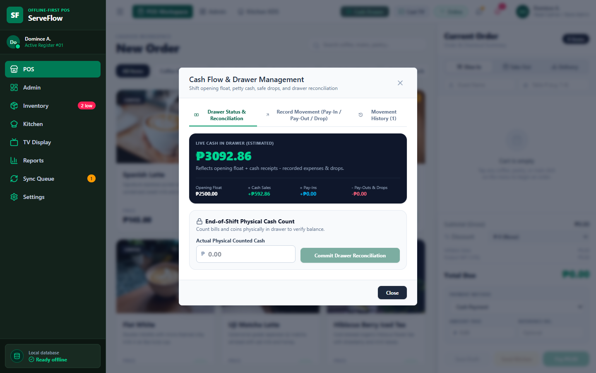
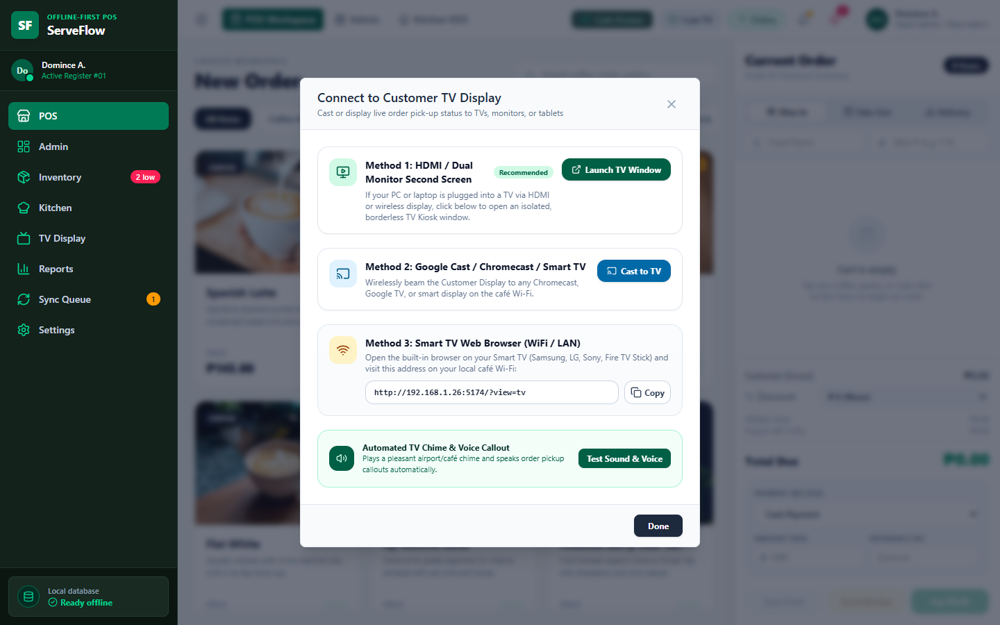
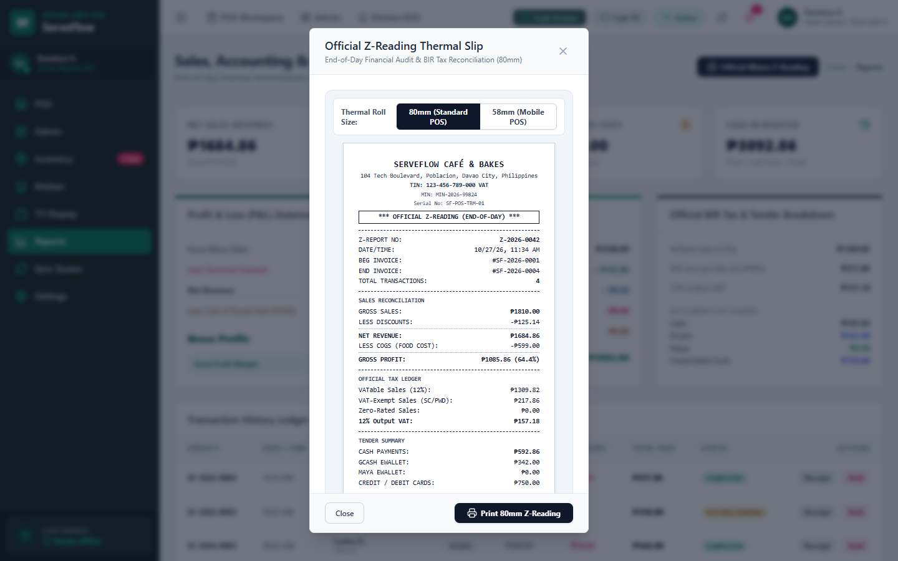
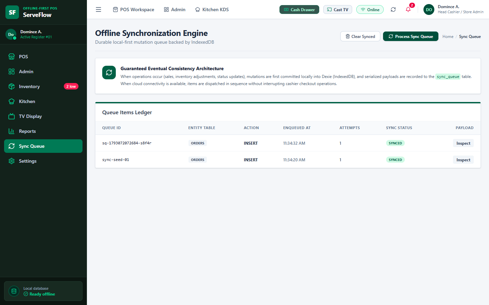
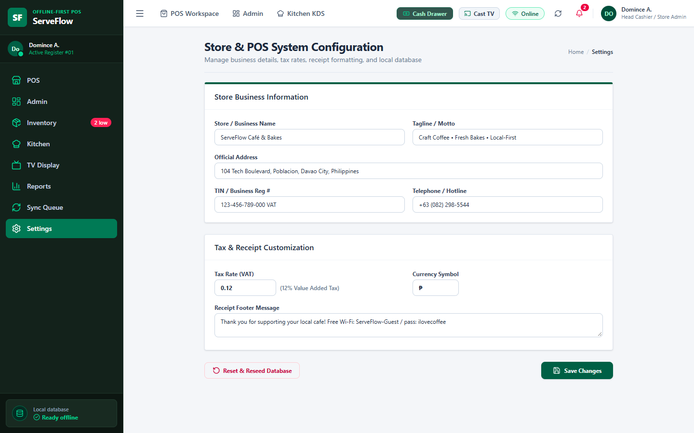
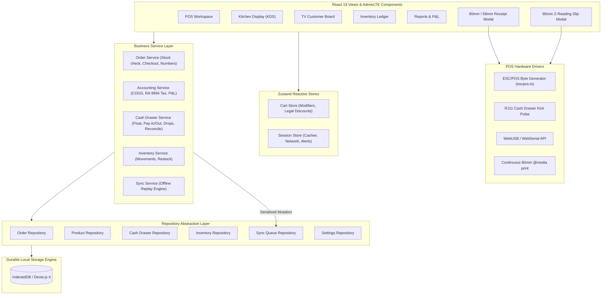

# 🧾 ServeFlow POS — Production-Grade Offline-First Point of Sale

[](https://react.dev/)
[](https://www.typescriptlang.org/)
[](https://vitejs.dev/)
[](https://dexie.org/)
[](https://tailwindcss.com/)
[](https://zustand-demo.pmnd.rs/)
[](LICENSE)
[]()

> **ServeFlow POS is an aggressively offline-first, local-sync Point of Sale (POS), Kitchen Display System (KDS), Cashflow, and TV Customer Kiosk ecosystem designed for cafés, coffee shops, and restaurants.**  
> Built strictly adhering to the **Repository Pattern** and the **AdminLTE enterprise design system**, ServeFlow runs entirely in the client runtime without requiring a cloud backend for day-to-day operations, complete with **hardware-grade 80mm/58mm thermal receipt printing**, **ESC/POS RJ11 cash drawer kick pulses**, and **Philippine RA 9994 / RA 10754 Senior & PWD tax compliance**.

---

## 📸 Real UI Showcase & Screen Walkthrough

Every screenshot below is captured directly from the live application runtime (`http://localhost:5174/`):

### 1. POS Cashier Workspace
High-density touch workspace featuring real high-resolution food and beverage photography, category filter pills (`Coffee & Espresso`, `Pastries & Bakes`, `Meals & Mains`, `Teas & Cold Drinks`), instant search, and stock health badges.


*Category tabs and search filter instantly with zero network delay:*


---

### 2. Cart Drawer with Modifiers & Philippine RA 9994 Senior/PWD Exemptions
Supports Dine In, Take Out, and Delivery order modes. Features line-item modifiers (*"Oat Milk Sub"*, *"Extra Shot"*), guest name, table identifiers, and Philippine legal discount computing (**RA 9994 Senior Citizen & PWD 20% VAT exemption** with required OSCA ID validation, Regular Member 10%, and Staff 15%).


---

### 3. Touchscreen Numeric Keypad & Smart Philippine Peso Bills
Cashiers can tap authentic, color-coded Philippine Peso bills (`₱20`, `₱50`, `₱100`, `₱200`, `₱500`, `₱1,000`) with **tap-to-accumulate** behavior (e.g., tapping ₱500 twice sets ₱1,000) or punch amounts directly on the on-screen numeric keypad. Automatically computes real-time customer change.


---

### 4. 80mm / 58mm Hardware Thermal Receipt & ESC/POS Protocol
Strictly formatted for commercial POS hardware printers. Supports **80mm standard rolls**, **58mm mobile rolls**, **ESC/POS binary download (`.bin`)**, direct **WebUSB / WebSerial** printing, and **RJ11 cash drawer kick pulses** (`ESC p 0 25 250`). Includes store TIN, MIN, Serial No, line-item modifiers, Senior/PWD identification, VATable Sales, VAT-Exempt Sales, and 12% Output VAT.


---

### 5. Cash Drawer & Shift Reconciliation
Full cash register audit tracking Morning Float (`₱2,500`), cash receipts, petty cash in (Pay-Ins), store expenses (Pay-Outs), and safe drops. End-of-shift physical bill counts automatically compute Short/Over discrepancies.



---

### 6. TV Second Screen & Google Cast Launcher
Allows cashiers to connect external ceiling displays and customer counter monitors with a single click via **HDMI / Dual-Monitor Second Screen**, **Google Cast / Chromecast**, or **Smart TV Web Browser (Wi-Fi/LAN)**.



---

### 7. Kitchen Display System (KDS)
Dispatched meal tickets immediately appear on the multi-column **Kitchen Display System (KDS)** with elapsed timer tracking:


*Tickets advance through Incoming → Cooking → Ready for Customer Pickup:*


---

### 8. Customer TV Order Status Display (Kiosk Mode)
Split-screen overhead kiosk board for counters and customer waiting areas displaying **Now Preparing** (amber) and **Ready for Pickup** (emerald) orders, alongside a live digital clock.


> **Automated Airport/Café Audio Chime & Synthetic Voice Callout:**  
> When the kitchen marks an order as Ready, the TV board rings a pleasant dual-tone synthesizer chime (`C5 523Hz → G5 784Hz`) and speaks the callout:  
> *"Ding-dong! Order number 4 for Maria Santos is now ready for pickup at the counter."*

---

### 9. Official End-of-Day 80mm Z-Reading Slip
Compliant daily financial audit report formatted as an authentic 80mm thermal slip, detailing Gross Sales, Discounts, Net Revenue, Cost of Goods Sold (COGS), Gross Profit, 12% VAT vs VAT-Exempt Sales, Cash/E-Wallet breakdown, drawer reconciliation, and cashier/manager signature blocks.



---

### 10. AdminLTE Analytics & Performance Dashboard
Displays real-time Net Sales, Total Orders, Average Ticket Size, Low-Stock Alerts, Hourly Velocity Visualizer, and Payment Method distribution.


---

### 11. Inventory Master Ledger & Cost of Goods Sold (COGS)
Full product catalog with photo thumbnails, stock quantities, unit cost prices (COGS), gross margin percentages, and one-click stock adjustment modals for deliveries, waste, and recounts.


---

### 12. Profit & Loss (P&L) Accounting Statement
Comprehensive business financial reports calculating Gross Sales, Deductions, Net Sales, Cost of Goods Sold (COGS), **Gross Profit**, **Gross Profit Margin %**, drawer cashflow reconciliations, and full transaction history ledger.


---

### 13. Offline Mutation Sync Queue Engine
Every order, payment, and inventory change writes a serialized payload into the local `syncQueue` table. When online connectivity is active, the dispatcher drains the queue with FIFO replay.

| Pending Mutations | Drained & Replayed |
| :---: | :---: |
|  |  |

---

### 14. Store Configuration & Hardware Preferences
Configure store name, address, tax rate (12% VAT), BIR TIN, Machine Identification Number (MIN), Terminal Serial Number, and receipt printer roll sizes.



---

## 🖨️ POS Hardware Printing & Thermal Specifications

ServeFlow is engineered to meet physical receipt printing standards:

### 1. Thermal Roll Sizing & Continuous Roll CSS
- **80mm Standard Thermal Roll:** Formatted to **72mm printable width** (48 columns Font A / 64 columns Font B, 576 dots at 203 DPI). Compatible with Epson TM-T88 / TM-T20, Star TSP100, Bixolon, Citizen, and Xprinter XP-80.
- **58mm Compact / Mobile Roll:** Formatted to **48mm printable width** (32 columns Font A / 42 columns Font B, 384 dots at 203 DPI). Compatible with mobile Bluetooth printers and Sunmi terminals.
- **Continuous Roll `@media print`:** Utilizes `@page { size: 80mm auto; margin: 0; }` to eliminate browser page breaks, A4 margins, headers, and unwanted blank roll spits.
- **DOM Isolation:** In print mode, all application UI (sidebar, top navbar, modal backdrop overlays, buttons) are hidden; only `#thermal-receipt-printable` is sent to the printer spooler.
- **20mm Auto-Cutter Clearance Margin:** Built-in paper feed spacing at the bottom of the receipt prevents the physical auto-cutter knife from slicing through the store footer text or tax disclaimers.
- **Pure 1-Bit Thermal Contrast:** All typography is forced to pure black (`#000000`) on white (`#ffffff`) without dithered grey tones that cause faint/blurry thermal printing.

### 2. ESC/POS Command Protocol (`src/utils/escpos.ts`)
For hardware setups requiring direct raw binary streams without browser print dialogues:
- **Cash Drawer Kick Pulse:** `\x1B\x70\x00\x19\xFA` (`ESC p 0 25 250`) sends an electrical pulse to the 24V solenoid cash drawer connected via the printer's RJ11/RJ12 port upon receipt finalization.
- **Auto-Paper Cut:** `\x1D\x56\x42\x00` (`GS V 66 0`) triggers the automatic receipt guillotine cut with feed.
- **Direct WebUSB & WebSerial:** Native Chromium support (`navigator.serial` / `navigator.usb`) to beam ESC/POS bytes directly over USB or RS232 COM ports.
- **Raw `.bin` Export:** Generates standalone binary files ready for Linux CUPS (`lp -d printer receipt.bin`), Windows spooler (`copy /b receipt.bin PRN`), or Android RawBT.

### 3. Philippine BIR Statutory Formatting (RA 9994 / RA 10754)
- Header: VAT-Registered TIN, Machine Identification Number (MIN), Terminal Serial Number, and Permit to Use (PTU) number.
- Itemized breakdown of **VATable Sales**, **VAT-Exempt Sales (Senior Citizen & PWD)**, **Zero-Rated Sales**, and **12% Output VAT**.
- Senior Citizen / PWD OSCA identification number printed alongside legal exemptions.
- Official disclaimer: *"THIS SERVES AS AN OFFICIAL SALES INVOICE"*.
- Dedicated **Official 80mm End-of-Day Z-Reading Slip** with cashier and store supervisor signature certification blocks.

---

## ⚡ "Ready to Use in Your App" Quick Start Guide

ServeFlow POS is designed to be **ready to run immediately** with zero complex backend setup. Simply clone and start:

### 1. Clone & Install Dependencies
```bash
git clone https://github.com/DominceAseberos/project-serveflow.git
cd project-serveflow
npm install
```

### 2. Start the Local Server
```bash
npm run dev -- --host
```
Open **`http://localhost:5174/`** in your browser. All database tables, initial categories, café menu items with food photography, and settings are automatically seeded on first launch into your browser's IndexedDB.

### 3. Build for Production / Static Hosting
```bash
npm run build
npm run preview
```
Deploy the generated `dist/` directory directly to Vercel, Cloudflare Pages, Netlify, or AWS S3. Because persistence is 100% local-first, the app requires zero server-side databases to run in production.

---

## 📺 Connecting to a TV or Second Screen

ServeFlow includes native multi-screen and casting support designed for café counters:

| Method | Instructions |
| :--- | :--- |
| **1. Dual-Monitor / HDMI Second Screen** | Click **`Launch TV Window`** from the navbar. Drag the opened borderless window to your ceiling TV and press **F11** for full-screen kiosk. The cashier continues taking orders on the main screen. |
| **2. Google Cast / Chromecast** | Click the **`Cast TV`** button in the top navbar. It triggers Chrome's native Cast context (`Presentation API`) to beam the customer display wirelessly to any Chromecast or Google TV. |
| **3. Smart TV Web Browser (Wi-Fi / LAN)** | Open the built-in browser on any Smart TV (Samsung Tizen, LG webOS, Android TV, Fire TV Stick) connected to the café Wi-Fi and enter: <br>`http://<YOUR-LOCAL-IP>:5174/?view=tv` |

*Sub-millisecond synchronization is powered by the HTML5 `BroadcastChannel` API—when an order is updated in the kitchen, the TV screen reacts with zero delay.*

---

## 🏛️ System Architecture

ServeFlow strictly enforces **Dependency Inversion** and the **Repository Pattern**. React components never execute direct IndexedDB database calls:



---

## 📁 Project Directory Structure

```text
src/
├── types/             # Strict TypeScript domain contracts (Product, Order, CashDrawer, Accounting)
├── db/                # Dexie database schema and initial café seed dataset
├── repositories/      # Repository boundaries isolating DB operations from views
├── services/          # Pure business services (Checkout, COGS, Cash Drawer, Sync)
├── stores/            # Zustand reactive stores (Cart, Session, Cashier)
├── utils/             # ESC/POS byte generator, Web Audio chime, SpeechSynthesis, BroadcastChannel
│   ├── escpos.ts      # 80mm/58mm ESC/POS commands, RJ11 drawer kick, WebSerial
│   ├── audioAnnouncer.ts # Airport-style dual-tone chime & voice synthesis
│   └── tvBroadcast.ts # BroadcastChannel cross-window sync
├── components/
│   ├── layout/        # AdminLTE Top Navbar, Sidebar, and Breadcrumbs
│   ├── common/        # Reusable AdminLTE InfoBox, Card, and Modal components
│   ├── pos/           # ProductCard, CartDrawer, PaymentModal, ReceiptModal
│   ├── cashflow/      # CashFlowModal (Opening float, petty cash, drawer reconciliation)
│   ├── reports/       # ZReadingModal (Official 80mm Z-Reading thermal slip)
│   └── tv/            # TvConnectModal (Google Cast, HDMI second screen, Smart TV LAN link)
├── views/             # Full application screens (POS, Admin, Inventory, KDS, TV, Reports, Sync, Settings)
└── App.tsx            # Application root and standalone TV router
```

---

## 🧪 Testing & Verification

Run the automated live browser click audit suite:
```bash
node scripts/audit-test.mjs
```
The suite launches a live Google Chrome engine, navigates through all views, tests DOM click events, exercises touch buttons and bills, verifies modal calculations, writes mutations to Dexie IndexedDB, tests KDS ticket transitions, and outputs 17 high-resolution real UI screenshot captures into `docs/screenshots/`.

---

## 📄 License

Distributed under the **MIT License**. Free for personal, commercial, and educational use.  
Crafted with ❤️ by **Domince Aseberos** • [dominceaseberos.tech](https://dominceaseberos.tech)
