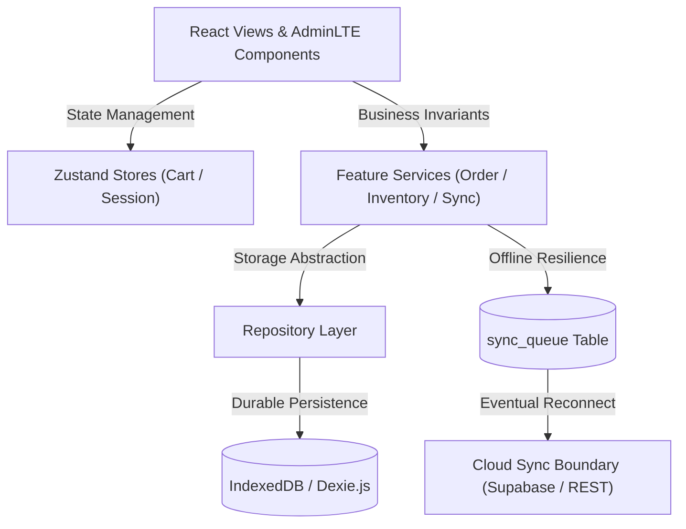
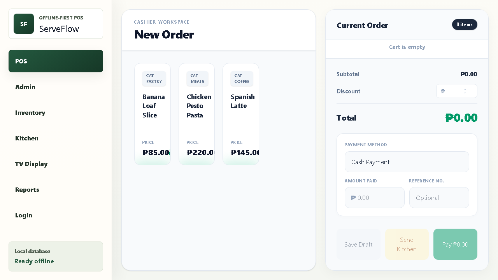

# 🧾 ServeFlow POS — AdminLTE Edition

> **Aggressively offline-first, local-sync Point of Sale (POS) ecosystem designed for cafés and restaurants.**  
> Built with **React 19**, **TypeScript**, **Vite**, **Zustand**, and **Dexie.js (IndexedDB)** adhering to the **Repository Pattern** and **AdminLTE 3/4 design guidelines**.

---

## 📸 Architecture & Design





---

## 🚀 Key Modules & Capabilities

1. **POS Cashier Workspace (`/pos`)**
   - Exact layout matching the original design specification.
   - Quick category filtering (`CAT-COFFEE`, `CAT-MEALS`, `CAT-PASTRY`, `CAT-DRINKS`).
   - Real-time cart drawer with Dine In / Take Out / Delivery order modes.
   - Cash denominations calculator, change counter, GCash / Maya e-wallet reference logger, and card support.
   - Printable 80mm thermal receipt generator with BIR-compliant VAT breakdown.

2. **Admin Dashboard (`/admin`)**
   - AdminLTE small info-boxes: Today's Revenue, Total Completed Orders, Low Stock Alerts, and Offline Sync Queue.
   - Hourly sales volume visualizer and tender channel breakdown (Cash vs E-Wallets vs Cards).
   - Live cashier shift tracker with local Dexie storage health check.

3. **Inventory & Stock Management (`/inventory`)**
   - Real-time stock counts with color-coded health indicators (Healthy, Low Stock, Depleted).
   - Stock movement ledger: logs deliveries, count adjustments, and waste write-offs.
   - Add new product modal writing directly to IndexedDB.

4. **Kitchen Display System (KDS) (`/kitchen`)**
   - Multi-column ticket progression: **Incoming** → **In Preparation** → **Ready for Pickup**.
   - Live elapsed-time tracking per ticket with instant visual state advance.

5. **TV Customer Display (`/tv`)**
   - Full-screen kiosk display for café counters and waiting areas.
   - Split-screen layout displaying **Now Preparing** (amber) and **Ready for Pickup** (emerald).

6. **Sales & Reports / Z-Reading (`/reports`)**
   - Automated End-of-Day Z-Reading generation (Gross Sales, Net Sales, VATable Sales, Discounts, Tender Breakdown).
   - Historical transaction ledger with Void / Refund capability.

7. **Durable Sync Queue Engine (`/sync`)**
   - Live inspector for pending offline mutations stored in the `sync_queue` table.
   - Payload JSON inspection, simulated cloud synchronization, and sync cleanup.

8. **Settings & Customization (`/settings`)**
   - Store details (TIN, address, contact, hotline).
   - Tax rate (VAT) adjuster and receipt footer customizer.
   - Instant database reseed and reset trigger.

---

## 🛠️ Getting Started

### 1. Install Dependencies
```bash
npm install
```

### 2. Start Development Server
```bash
npm run dev
```

Open `http://localhost:5173` in any browser. All tables are automatically seeded on first launch.

### 3. Production Build & Verification
```bash
npm run build
npm run preview
```

---

## 🏛️ Project Directory Structure

```text
src/
├── types/             # Domain contracts (Product, Order, SyncQueue, Category, Settings)
├── db/                # Dexie database schema and initial café seed dataset
├── repositories/      # Repository boundaries decoupling DB operations from views
├── services/          # Pure business services (Checkout validation, inventory deductions, sync)
├── stores/            # Zustand reactive stores (Cart, cashier session, active view)
├── components/
│   ├── layout/        # AdminLTE Top Navbar, Sidebar, and Breadcrumbs
│   ├── common/        # Reusable AdminLTE InfoBox, Card, and Modal components
│   └── pos/           # ProductCard, CartDrawer, PaymentModal, ReceiptModal
├── views/             # Full view screens (POS, Admin, Inventory, KDS, TV, Reports, Sync, Settings)
└── App.tsx            # Main application shell and routing controller
```
