# 🧾 ServeFlow POS — Production-Grade Offline-First Point of Sale

[](https://react.dev/)
[](https://www.typescriptlang.org/)
[](https://vitejs.dev/)
[](https://dexie.org/)
[](https://tailwindcss.com/)
[](https://zustand-demo.pmnd.rs/)
[](LICENSE)
[]()

> **ServeFlow POS is an aggressively offline-first, local-sync Point of Sale (POS), Kitchen Display (KDS), and Cashflow Management ecosystem designed for cafés, coffee shops, and restaurants.**  
> Built strictly adhering to the **Repository Pattern** and the **AdminLTE enterprise design system**, ServeFlow runs entirely in the browser runtime without requiring a cloud backend for day-to-day operations.

---

## 📸 Visual Showcase & Screen Walkthrough

### 1. POS Cashier Workspace
High-density touch workspace featuring real high-resolution food and beverage photography, category filter pills (`Coffee & Espresso`, `Pastries & Bakes`, `Meals & Mains`, `Teas & Cold Drinks`), instant search, and stock health badges.

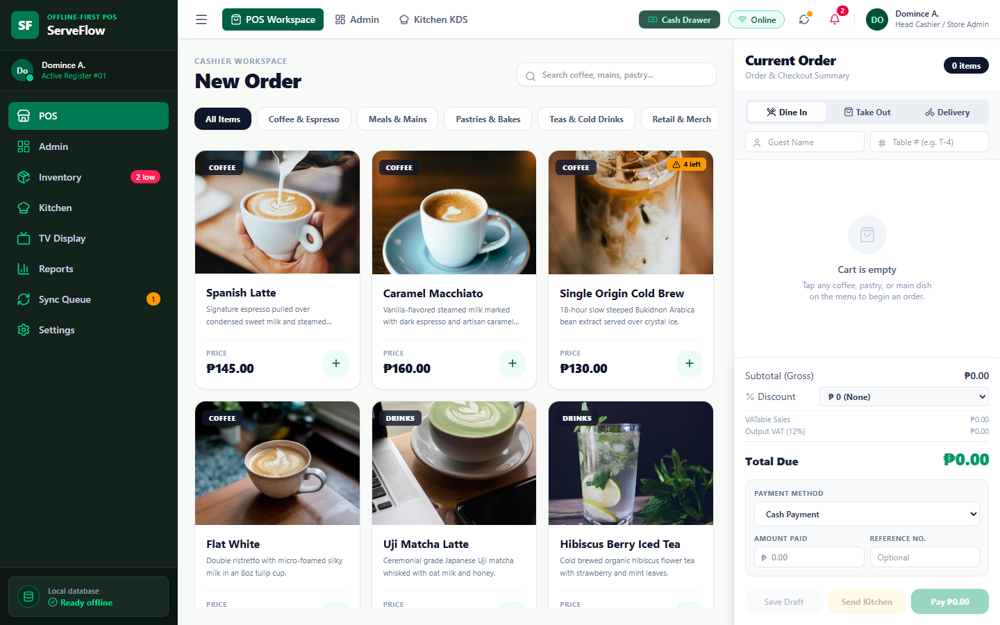

*Category tabs and search filter instantly with zero network delay:*
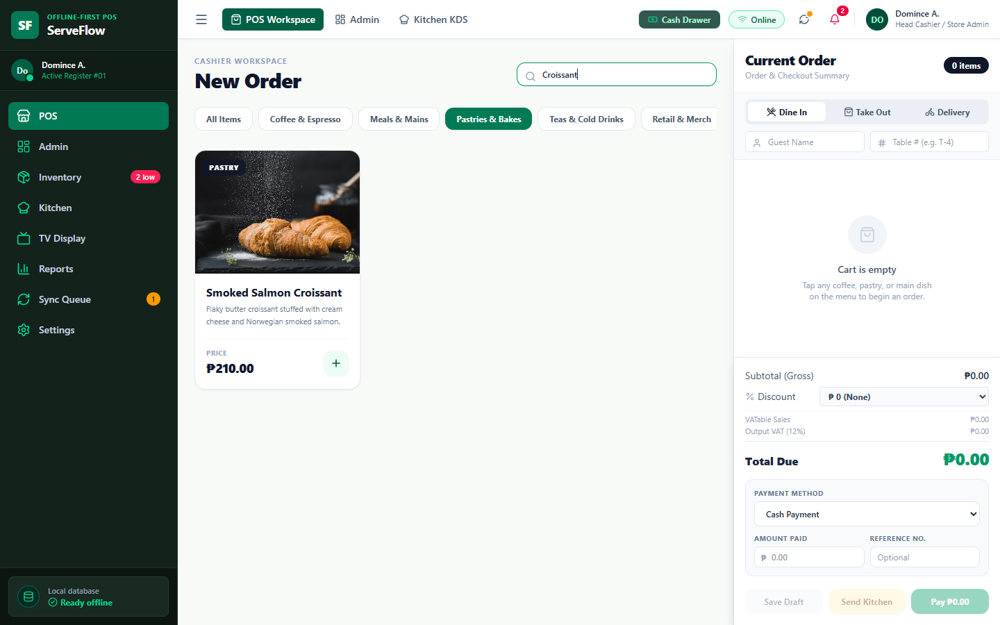

---

### 2. Cart Drawer with Modifiers & Legal Discounts
Supports Dine In, Take Out, and Delivery order types. Features line-item special instructions (*"Oat Milk Sub"*, *"Less Ice"*, *"Extra Shot"*), guest name, table identifiers, and Philippine legal discount presets (**RA 9994 Senior Citizen & PWD 20% VAT exemption** with required OSCA ID validation, Regular Member 10%, and Staff 15%).

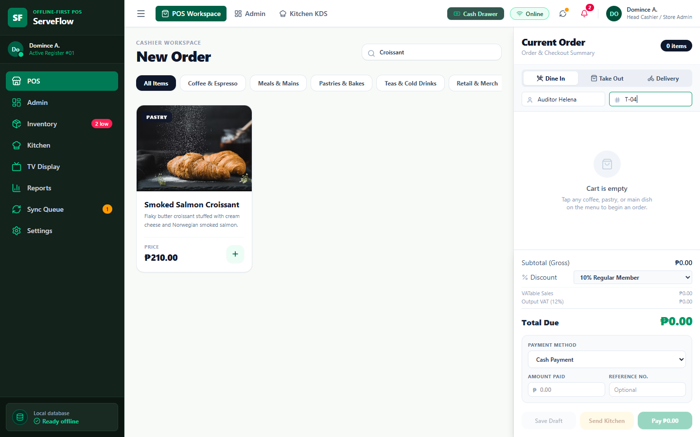

---

### 3. Touchscreen Numeric Keypad & Smart Philippine Peso Bills
Cashiers can tap authentic, color-coded Philippine Peso bills (`₱20`, `₱50`, `₱100`, `₱200`, `₱500`, `₱1,000`) with **tap-to-accumulate** behavior (e.g., tapping ₱500 twice sets ₱1,000) or punch amounts directly on the on-screen numeric keypad. Automatically computes real-time customer change.

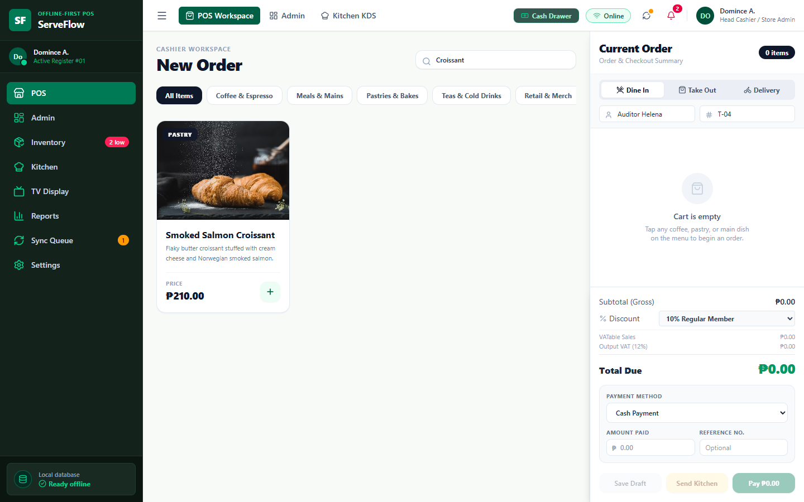

---

### 4. 80mm BIR Thermal Receipt & Kitchen Display System (KDS)
Instantly renders printable 80mm thermal receipts with store TIN, MIN, line-item modifiers, Senior/PWD identification, VATable Sales, VAT-Exempt Sales, and 12% Output VAT.

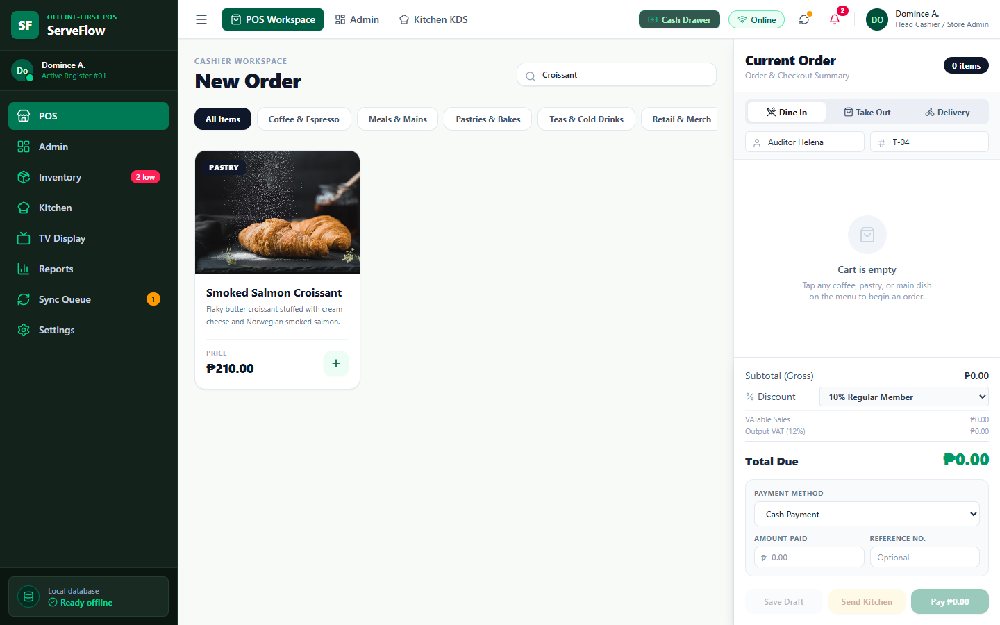

Dispatched meal tickets immediately appear on the multi-column **Kitchen Display System (KDS)** with elapsed timer tracking:

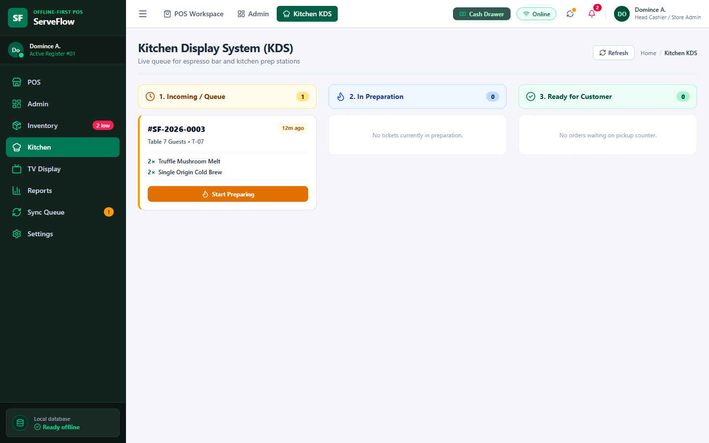

*Tickets advance through Incoming → Cooking → Ready for Customer Pickup:*
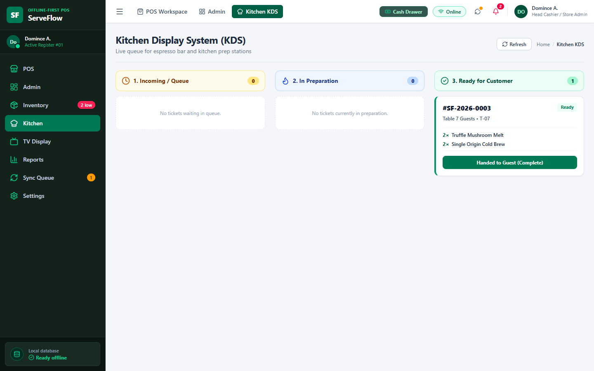

---

### 5. Customer TV Order Status Display (Kiosk Mode)
Split-screen overhead kiosk board for counters and customer waiting areas displaying **Now Preparing** (amber) and **Ready for Pickup** (emerald) orders, alongside a live digital clock.

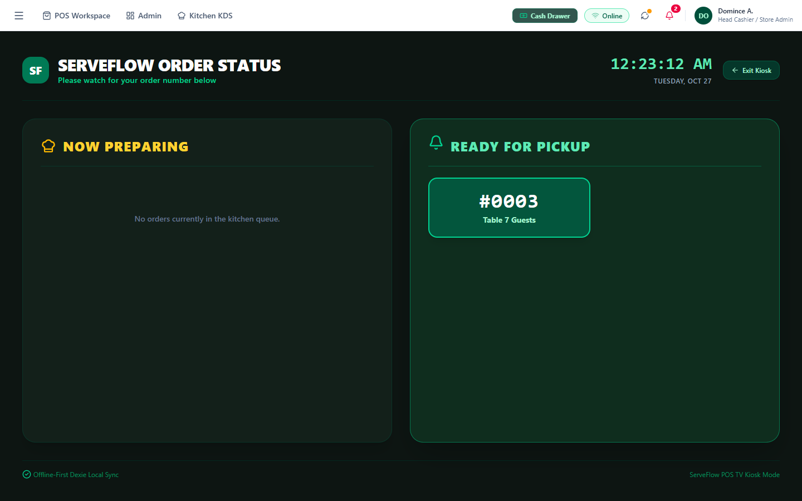

> **Automated Airport/Café Audio Chime & Synthetic Voice Callout:**  
> When the kitchen marks an order as Ready, the TV board rings a pleasant dual-tone synthesizer chime (`C5 523Hz → G5 784Hz`) and speaks the callout:  
> *"Ding-dong! Order number 4 for Maria Santos is now ready for pickup at the counter."*

---

### 6. AdminLTE Analytics & Performance Dashboard
Displays real-time Net Sales, Total Orders, Average Ticket Size, Low-Stock Alerts, Hourly Velocity Visualizer, and Payment Method distribution.

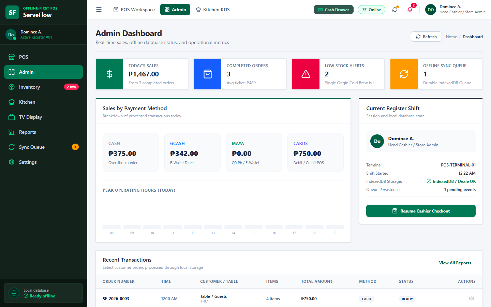

---

### 7. Inventory Master Ledger & Cost of Goods Sold (COGS)
Full product catalog with photo thumbnails, stock quantities, unit cost prices (COGS), gross margin percentages, and one-click stock adjustment modals for deliveries, waste, and recounts.

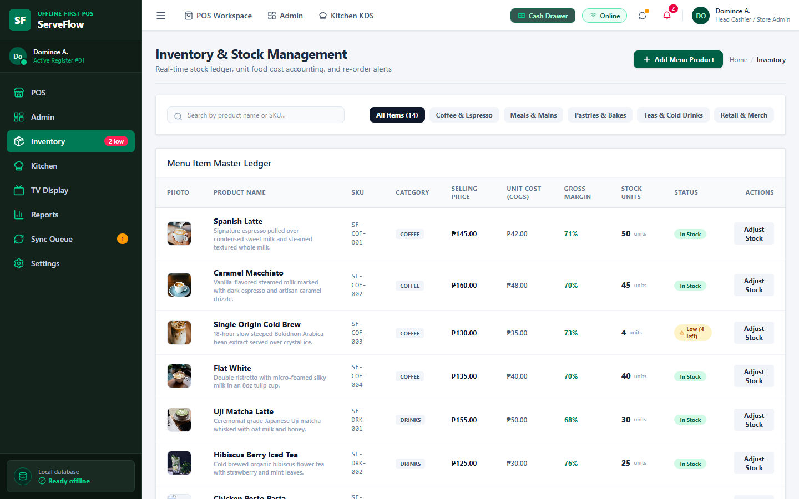

---

### 8. Profit & Loss (P&L) Accounting & Official Z-Reading
Comprehensive business financial reports calculating Gross Sales, Discounts, Net Sales, Cost of Goods Sold (COGS), **Gross Profit**, **Gross Profit Margin %**, drawer cashflow reconciliations, and printable official End-of-Day Z-Readings.

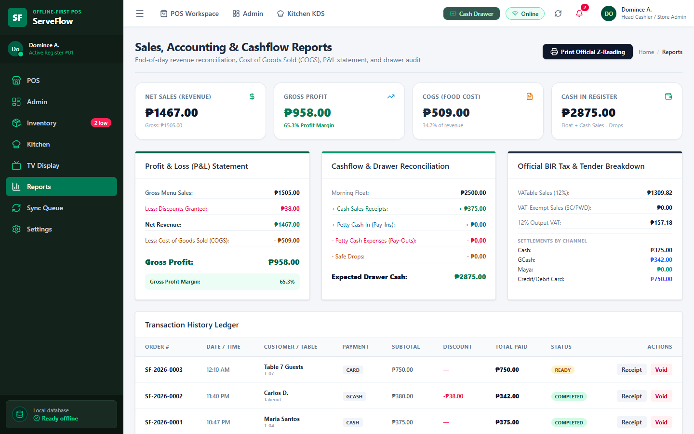

---

### 9. Offline Mutation Sync Queue Engine
Every order, payment, and inventory change writes a serialized payload into the local `syncQueue` table. When online connectivity is active, the dispatcher drains the queue with FIFO replay.

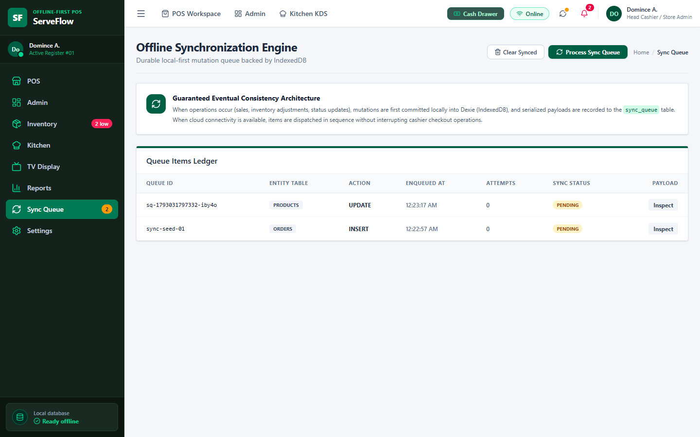

---

## ⚡ "Ready to Use in Your App" Quick Start Guide

ServeFlow POS is designed to be **ready to run immediately** with zero complex backend setup. Simply clone and start:

### 1. Clone & Install Dependencies
```bash
git clone https://github.com/DominceAseberos/project-serveflow.git
cd project-serveflow
npm install
```

### 2. Start the Local Server
```bash
npm run dev -- --host
```
Open **`http://localhost:5174/`** in your browser. All database tables, initial categories, café menu items with food photography, and settings are automatically seeded on first launch into your browser's IndexedDB.

### 3. Build for Production / Static Hosting
```bash
npm run build
npm run preview
```
Deploy the generated `dist/` directory directly to Vercel, Cloudflare Pages, Netlify, or AWS S3. Because persistence is 100% local-first, the app requires zero server-side databases to run in production.

---

## 📺 Connecting to a TV or Second Screen

ServeFlow includes native multi-screen and casting support designed for café counters:

| Method | Instructions |
| :--- | :--- |
| **1. Dual-Monitor / HDMI Second Screen** | Click **`Launch TV Window`** from the navbar. Drag the opened borderless window to your ceiling TV and press **F11** for full-screen kiosk. The cashier continues taking orders on the main screen. |
| **2. Google Cast / Chromecast** | Click the **`Cast TV`** button in the top navbar. It triggers Chrome's native Cast context (`Presentation API`) to beam the customer display wirelessly to any Chromecast or Google TV. |
| **3. Smart TV Web Browser (Wi-Fi / LAN)** | Open the built-in browser on any Smart TV (Samsung Tizen, LG webOS, Android TV, Fire TV Stick) connected to the café Wi-Fi and enter: <br>`http://<YOUR-LOCAL-IP>:5174/?view=tv` |

*Sub-millisecond synchronization is powered by the HTML5 `BroadcastChannel` API—when an order is updated in the kitchen, the TV screen reacts with zero delay.*

---

## 🏛️ System Architecture

ServeFlow strictly enforces **Dependency Inversion** and the **Repository Pattern**. React components never execute direct IndexedDB database calls:

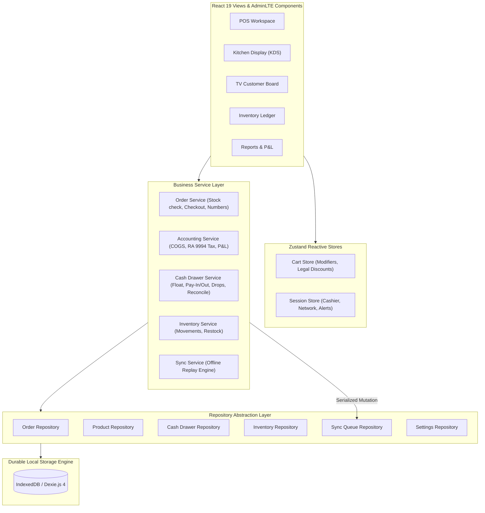

---

## 🛠️ Complete Feature Matrix

- [x] **Aggressively Offline-First**: Operates seamlessly through network outages; never blocks cashiers.
- [x] **High-Resolution Food Photography**: Appetizing imagery across coffee, pastries, and mains with full zoom modals.
- [x] **Touch POS Ergonomics**: On-screen numeric touchpad and authentic Philippine Peso bill buttons (`₱20` to `₱1,000`) with tap-to-accumulate.
- [x] **Line-Item Modifiers**: Add custom instructions (*"Oat Milk"*, *"Less Ice"*, *"Extra Shot"*) per item.
- [x] **Philippine RA 9994 / RA 10754 Tax Formula**: Legal 12% VAT exemption and 20% discount on net price (`(Gross / 1.12) * 0.80`) with OSCA ID recording.
- [x] **Full Cash Drawer & Cashflow Engine**: Opening float, petty cash in, pay-outs, safe drops, and shift drawer count reconciliation with automatic over/short calculations.
- [x] **Kitchen Display System (KDS)**: 3-column ticket lifecycle with elapsed time indicators.
- [x] **TV Customer Display Kiosk**: Standalone kiosk mode with digital clock, sub-millisecond broadcast sync, and automated airport-style dual-tone chime & voice announcements.
- [x] **Cost of Goods Sold (COGS) & P&L**: Item-level unit costs, gross profit calculation, and gross profit margin percentages.
- [x] **BIR 80mm Thermal Receipts**: Compliant formatting with TIN, MIN, line items, discounts, and VAT summaries.
- [x] **Durable Sync Queue**: Background queue with automatic retry logic for eventual cloud reconciliation.
- [x] **Automated Browser Click Audit**: Verified with automated Google Chrome Puppeteer click testing (`scripts/audit-test.mjs`).

---

## 📁 Project Directory Structure

```text
src/
├── types/             # Strict TypeScript domain contracts (Product, Order, CashDrawer, Accounting)
├── db/                # Dexie database schema and initial café seed dataset
├── repositories/      # Repository boundaries isolating DB operations from views
├── services/          # Pure business services (Checkout, COGS, Cash Drawer, Sync)
├── stores/            # Zustand reactive stores (Cart, Session, Cashier)
├── utils/             # Web Audio chime, SpeechSynthesis voice callouts, BroadcastChannel
├── components/
│   ├── layout/        # AdminLTE Top Navbar, Sidebar, and Breadcrumbs
│   ├── common/        # Reusable AdminLTE InfoBox, Card, and Modal components
│   ├── pos/           # ProductCard, CartDrawer, PaymentModal, ReceiptModal
│   ├── cashflow/      # CashFlowModal (Opening float, petty cash, drawer reconciliation)
│   └── tv/            # TvConnectModal (Google Cast, HDMI second screen, Smart TV LAN link)
├── views/             # Full application screens (POS, Admin, Inventory, KDS, TV, Reports, Sync, Settings)
└── App.tsx            # Application root and standalone TV router
```

---

## 🧪 Testing & Verification

Run the automated live browser click audit suite:
```bash
node scripts/audit-test.mjs
```
The suite launches a live headless Google Chrome engine, navigates through all 10 views, executes real DOM clicks, verifies modal calculations, mutates the local Dexie database, tests KDS ticket transitions, and outputs 14 high-resolution screenshot captures into `docs/screenshots/`.

---

## 📄 License

Distributed under the **MIT License**. Free for personal, commercial, and educational use.  
Crafted with ❤️ by **Domince Aseberos** • [dominceaseberos.tech](https://dominceaseberos.tech)
